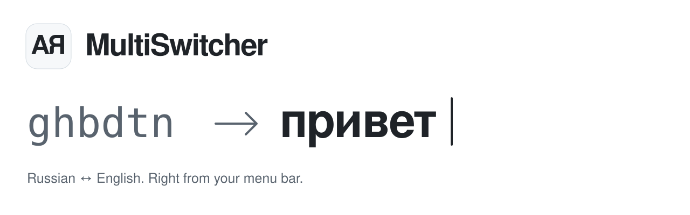
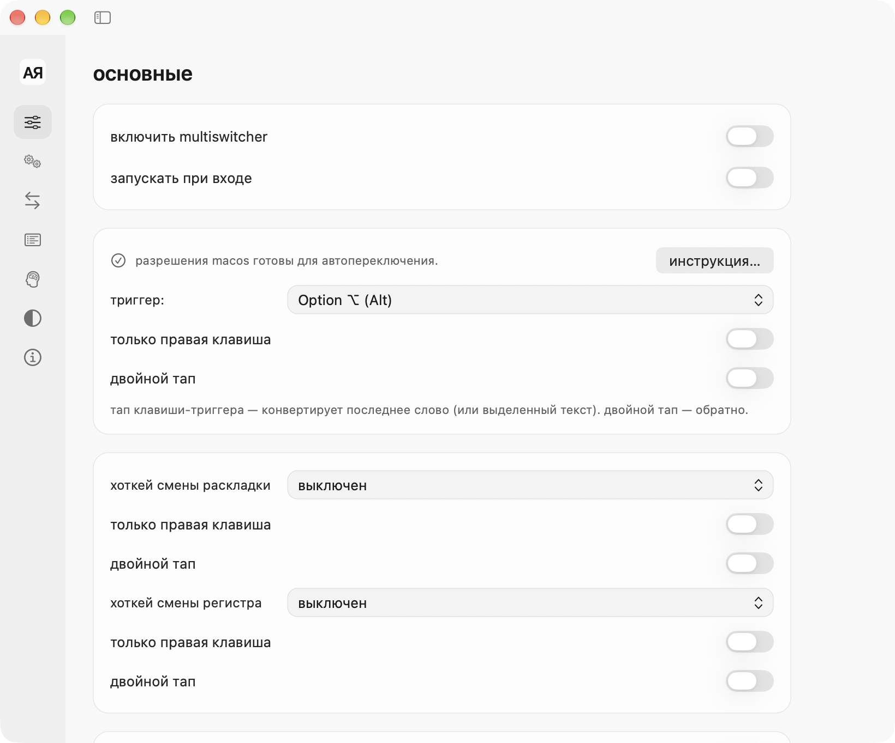

<p align="right"><a href="README.md">Русский</a> · <b>English</b></p>

<picture>
  <source media="(prefers-color-scheme: dark)" srcset=".github/assets/header-dark.en.svg">
  <source media="(prefers-color-scheme: light)" srcset=".github/assets/header-light.en.svg">
  
</picture>

<p align="center">
  <a href="https://github.com/SokolovMO/MultiSwitcher/actions/workflows/multi-switcher-ci.yml"></a>
  
  
  <a href="LICENSE"></a>
</p>

<p align="center">
  <b><a href="https://sokolovmo.ru/multiswitcher/">Download for macOS</a></b> &nbsp;·&nbsp;
  <a href="#install">Install</a> &nbsp;·&nbsp;
  <a href="SUPPORT.en.md">Get help</a> &nbsp;·&nbsp;
  <a href="https://github.com/SokolovMO/MultiSwitcher/issues/new/choose">Report a bug</a>
</p>

## Keep typing. Fix the layout.

MultiSwitcher is a native macOS menu-bar app for Russian and English typing.
It corrects words entered in the wrong keyboard layout, converts selected text,
and lets you decide when automatic correction should step aside.

- **Correct as you type.** Detect layout mismatches at word boundaries, with local dictionaries and rules.
- **Fix it with a key.** Use the configurable Option shortcut for a word or selection, with undo for replacements.
- **Make it yours.** Set exceptions, per-app exclusions, custom rules, and layout preferences.
- **Keep your profile.** Import a Punto profile, review learning candidates, and restore profile backups.
- **Stay native.** Light and dark appearances, Russian and English UI, system permissions, and signed Sparkle updates.
- **Process text locally.** Typed text, clipboard contents, and profiles are not sent with update checks.

<a href="https://sokolovmo.ru/multiswitcher/#video">
  
</a>

<sub>A 10-second product demo. <a href="https://sokolovmo.ru/multiswitcher/#video">watch the full video with sound</a>.</sub>

<picture>
  <source media="(prefers-color-scheme: dark)" srcset="design/interface-audit-2026-11-06/final-matrix/dark-0.png">
  <source media="(prefers-color-scheme: light)" srcset="design/interface-audit-2026-11-06/final-matrix/light-0.png">
  
</picture>

<sub>Settings captured during interface validation. Appearance follows your selected theme.</sub>

## Install

**Requires an Apple Silicon Mac and macOS 15 or newer.** Intel builds are not provided.

### Download the app

1. Get the DMG from the [official download page](https://sokolovmo.ru/multiswitcher/).
2. Move **MultiSwitcher** to **Applications** and open it.
3. Use **Setup Guide…** to grant **Accessibility** and **Input Monitoring** permissions in System Settings.

> [!IMPORTANT]
> This is an early, independently distributed app. It is **not Apple-notarized**;
> macOS may require allowing the first launch in **Privacy & Security**.
> Current downloads and updates are hosted on the official website, not GitHub Releases.

### Homebrew

```sh
brew tap SokolovMO/apps
HOMEBREW_MULTI_APPS_ALLOW_UNNOTARIZED=1 brew install --cask SokolovMO/apps/multiswitcher
```

The environment variable explicitly permits the cask to remove quarantine from
this app after verifying its code signature. It does not disable Gatekeeper for
other apps. For existing installations, adoption, and upgrades, see the
[Homebrew instructions](homebrew-tap/README.md).

### Update

Choose **Check for Updates** in the menu or **Settings → About**. Sparkle checks
Ed25519-signed update archives and asks before installing. See
[release notes](CHANGELOG.en.md) and [release information](RELEASE.md) for details.

## Your text stays on your Mac

Layout detection, dictionaries, rules, and learning run locally. Update checks
contact `sokolovmo.ru`; your text and profile are not part of these requests.
The current distribution does not include crash reporting. Optional reporting
exists in the source for builds explicitly configured for it.

macOS Secure Input can temporarily pause correction and shortcuts. The menu
identifies the app holding Secure Input and offers recovery instructions.
Read [Privacy](PRIVACY.md) and [Permissions & troubleshooting](SUPPORT.en.md) for details.

## Build from source

You need macOS 15 or newer and Swift 6 Command Line Tools. Full Xcode is required
for builds with release integrations and the complete asset catalog.

```sh
git clone https://github.com/SokolovMO/MultiSwitcher.git
cd MultiSwitcher
swift run --package-path macos MultiSwitcherCoreTests
bash macos/build_app.sh
```

With Command Line Tools alone, the app build falls back to its bundled `.icns`
when `actool` is unavailable. Local builds do not inherit the publisher's signing
identity. See [Contributing](CONTRIBUTING.en.md) for checks and development conventions,
and [Distribution](DISTRIBUTION.md) for the release process.

## Help shape MultiSwitcher

[Report a reproducible bug](https://github.com/SokolovMO/MultiSwitcher/issues/new?template=bug_report.yml),
[suggest a feature](https://github.com/SokolovMO/MultiSwitcher/issues/new?template=feature_request.yml),
or read the [contribution guide](CONTRIBUTING.en.md) before sending a pull request.
Reports in Russian and English are welcome. Use synthetic examples such as
`ghbdtn`, and keep private text and raw logs out of public reports.

Security concerns belong in [private vulnerability reports](https://github.com/SokolovMO/MultiSwitcher/security/advisories/new),
not public issues. See the [security policy](SECURITY.en.md).

## Other apps

[MultiShift](https://github.com/SokolovMO/MultiShift) brings file conversion and editing to Finder with a drag-and-drop action wheel. Part of the same Multi app family.

## License

[MIT](LICENSE). Original copyright notices are preserved.
Bundled dictionaries and dependencies have their own
[third-party notices](THIRD-PARTY-NOTICES.md).

Maintained by [SokolovMO](https://github.com/SokolovMO).
