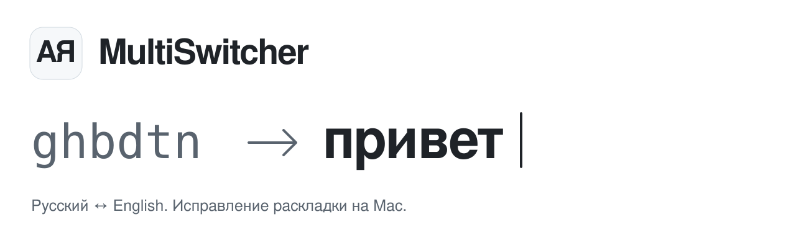
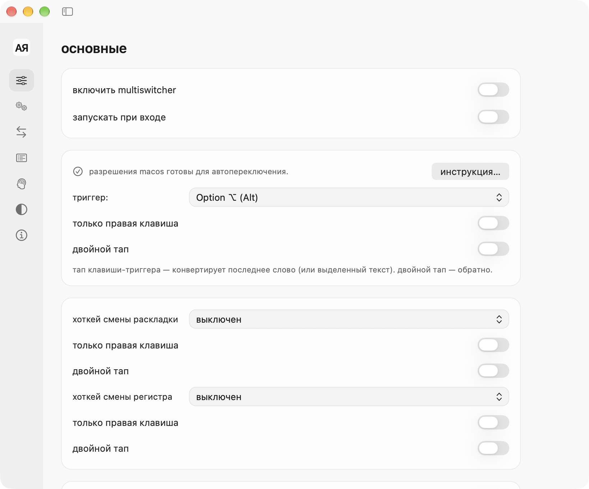

<p align="right"><b>Русский</b> · <a href="README.en.md">English</a></p>

<picture>
  <source media="(prefers-color-scheme: dark)" srcset=".github/assets/header-dark.svg">
  <source media="(prefers-color-scheme: light)" srcset=".github/assets/header-light.svg">
  
</picture>

<p align="center">
  <a href="https://github.com/SokolovMO/MultiSwitcher/actions/workflows/multi-switcher-ci.yml"></a>
  
  
  <a href="LICENSE"></a>
</p>

<p align="center">
  <b><a href="https://sokolovmo.ru/multiswitcher/">Скачать для macOS</a></b> &nbsp;·&nbsp;
  <a href="#установка">Установка</a> &nbsp;·&nbsp;
  <a href="SUPPORT.md">Помощь</a> &nbsp;·&nbsp;
  <a href="https://github.com/SokolovMO/MultiSwitcher/issues/new/choose">Сообщить об ошибке</a>
</p>

## Пишите дальше. Раскладку исправим.

MultiSwitcher — нативное приложение для macOS, которое живёт в строке меню
и помогает печатать на русском и английском. Исправляйте слова, набранные
в другой раскладке, конвертируйте выделенный текст и выбирайте, когда
автоматическое исправление должно уступить вам управление.

- **Исправление при наборе.** Определение раскладки на границе слова, локальные словари и правила.
- **Конвертация одной клавишей.** Настраиваемая клавиша Option для слова или выделения и отмена замен.
- **Ваши правила.** Исключения для слов и приложений, пользовательские замены и запоминание раскладки.
- **Ваш профиль.** Импорт из Punto, подтверждение кандидатов обучения и восстановление резервных копий.
- **Нативный интерфейс.** Светлая и тёмная темы, русский и английский языки, системные разрешения и обновления Sparkle.
- **Локальная обработка.** Набранный текст, буфер обмена и профиль не отправляются при проверке обновлений.

<a href="https://sokolovmo.ru/multiswitcher/#video">
  
</a>

<sub>10 секунд о работе приложения. <a href="https://sokolovmo.ru/multiswitcher/#video">открыть полное видео со звуком</a>.</sub>

<picture>
  <source media="(prefers-color-scheme: dark)" srcset="design/interface-audit-2026-11-06/final-matrix/dark-0.png">
  <source media="(prefers-color-scheme: light)" srcset="design/interface-audit-2026-11-06/final-matrix/light-0.png">
  
</picture>

<sub>Реальный интерфейс из проверки приложения. Оформление соответствует выбранной теме.</sub>

<a id="install"></a>

## Установка

**Нужны Mac с Apple Silicon и macOS 15 или новее.** Сборок для Intel нет.

### Скачать приложение

1. Загрузите DMG с [официальной страницы](https://sokolovmo.ru/multiswitcher/).
2. Перенесите **MultiSwitcher** в **Программы** и откройте его.
3. Через инструкцию настройки выдайте доступ к **Универсальному доступу** и **Мониторингу ввода** в системных настройках.

> [!IMPORTANT]
> Приложение находится на раннем этапе и распространяется самостоятельно,
> **без нотарификации Apple**. При первом запуске macOS может попросить разрешить
> открытие в разделе **Конфиденциальность и безопасность**.
> Дистрибутивы и обновления размещены на официальном сайте, а не в GitHub Releases.

### Homebrew

```sh
brew tap SokolovMO/apps
HOMEBREW_MULTI_APPS_ALLOW_UNNOTARIZED=1 brew install --cask SokolovMO/apps/multiswitcher
```

Переменная окружения явно разрешает cask снять карантин с этого приложения
после проверки подписи кода. Gatekeeper для других приложений остаётся включённым.
Если приложение уже установлено, смотрите
[инструкции Homebrew по подключению и обновлению](homebrew-tap/README.md).

### Обновления

Выберите **Проверить обновления** в меню или в разделе **Настройки → О приложении**.
Sparkle проверит подпись Ed25519 и запросит подтверждение установки.
[История изменений](CHANGELOG.md) и [сведения о выпуске](RELEASE.md) описывают изменения и проверки.

## Текст остаётся на вашем Mac

Определение раскладки, словари, правила и обучение работают локально.
Проверка обновлений обращается к `sokolovmo.ru`, но не передаёт ваш текст и профиль.
В текущем дистрибутиве нет отправки отчётов о сбоях. В исходниках предусмотрена
необязательная интеграция для сборок, где её явно настроили.

Защищённый ввод macOS может временно приостановить исправления и горячие клавиши.
В меню видно, какое приложение его удерживает, и как восстановить работу.
Подробнее: [конфиденциальность](PRIVACY.md) и [справка по разрешениям](SUPPORT.md).

<a id="build-from-source"></a>

## Сборка из исходников

Нужны macOS 15 или новее и Swift 6 Command Line Tools. Для сборок с релизными
интеграциями и полным каталогом ресурсов нужен Xcode.

```sh
git clone https://github.com/SokolovMO/MultiSwitcher.git
cd MultiSwitcher
swift run --package-path macos MultiSwitcherCoreTests
bash macos/build_app.sh
```

При сборке только с Command Line Tools используется готовая иконка `.icns`,
если недоступен `actool`. Локальная сборка не получает сертификат издателя.
Проверки и правила работы с кодом описаны в [CONTRIBUTING.md](CONTRIBUTING.md),
процесс выпуска — в [DISTRIBUTION.md](DISTRIBUTION.md).

## Участие в проекте

[Сообщите об ошибке](https://github.com/SokolovMO/MultiSwitcher/issues/new?template=bug_report.yml),
[предложите улучшение](https://github.com/SokolovMO/MultiSwitcher/issues/new?template=feature_request.yml)
или прочитайте [руководство для участников](CONTRIBUTING.md) перед отправкой PR.
Можно писать по-русски и по-английски. Используйте вымышленные примеры вроде
`ghbdtn`, не публикуйте личные сообщения и необработанные журналы.

Об уязвимостях сообщайте через
[закрытый отчёт](https://github.com/SokolovMO/MultiSwitcher/security/advisories/new).
Подробности — в [политике безопасности](SECURITY.md).

## Другие приложения

[MultiShift](https://github.com/SokolovMO/MultiShift) — конвертация и обработка копий файлов через колесо действий в Finder. Второе приложение семейства Multi.

## Лицензия

[MIT](LICENSE). Исходные уведомления об авторских правах сохранены.
Для словарей и зависимостей действуют отдельные
[уведомления](THIRD-PARTY-NOTICES.md).

Проект поддерживает [SokolovMO](https://github.com/SokolovMO).
