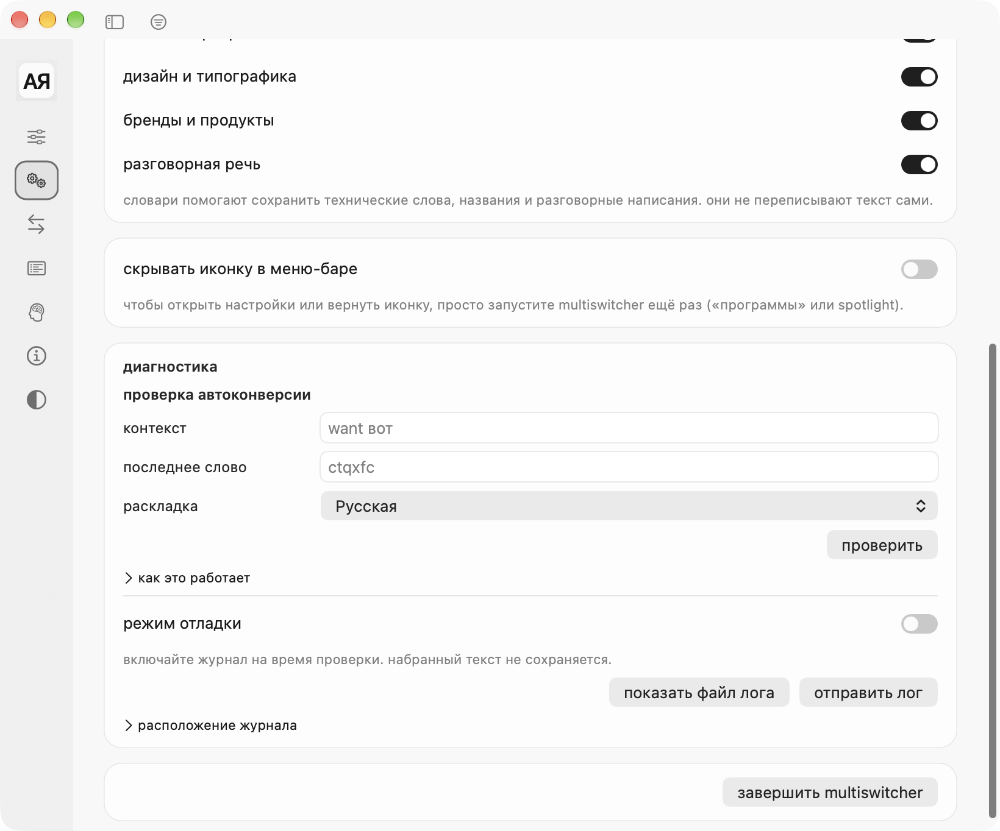
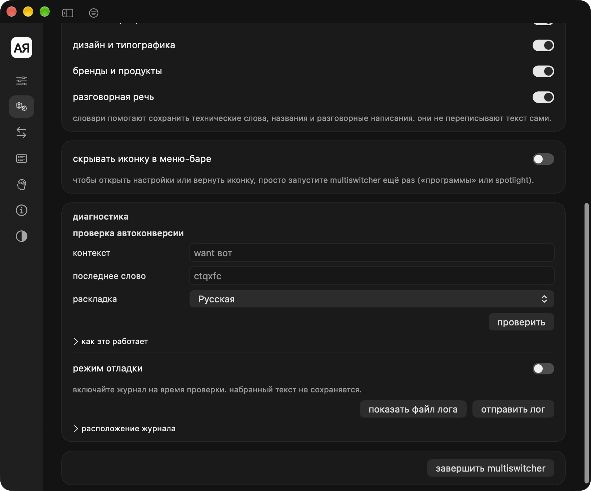
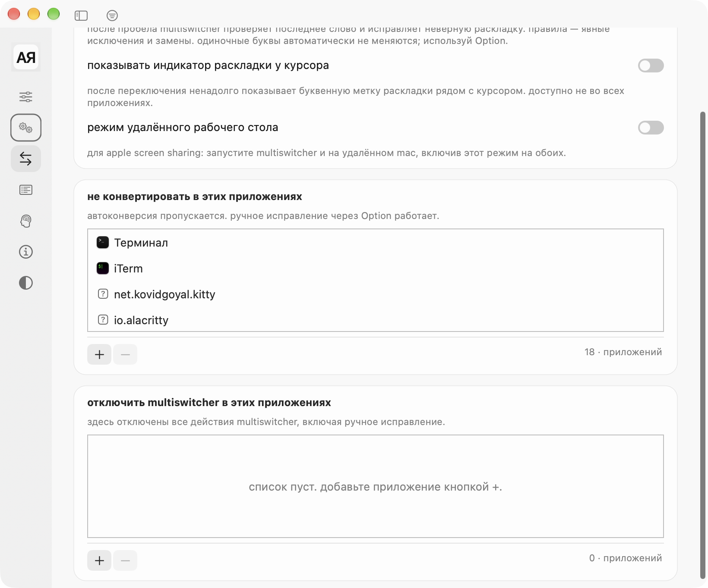
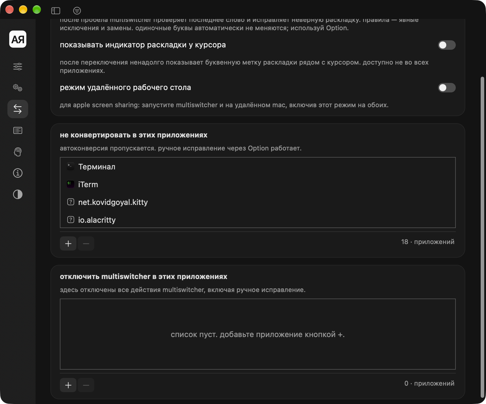
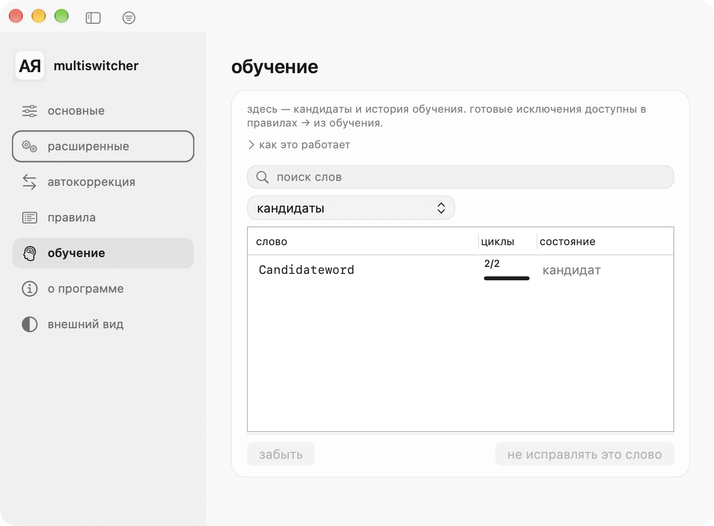
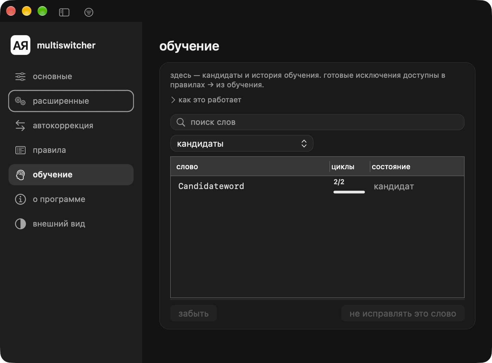
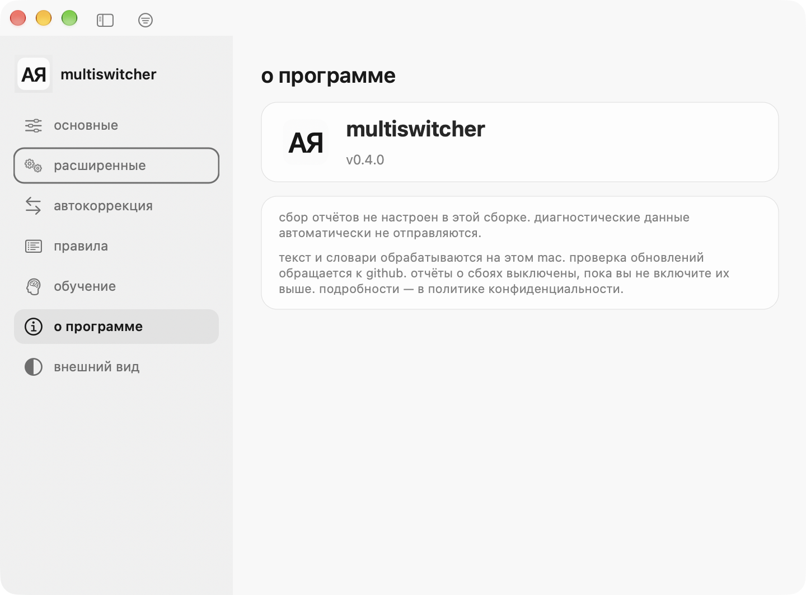
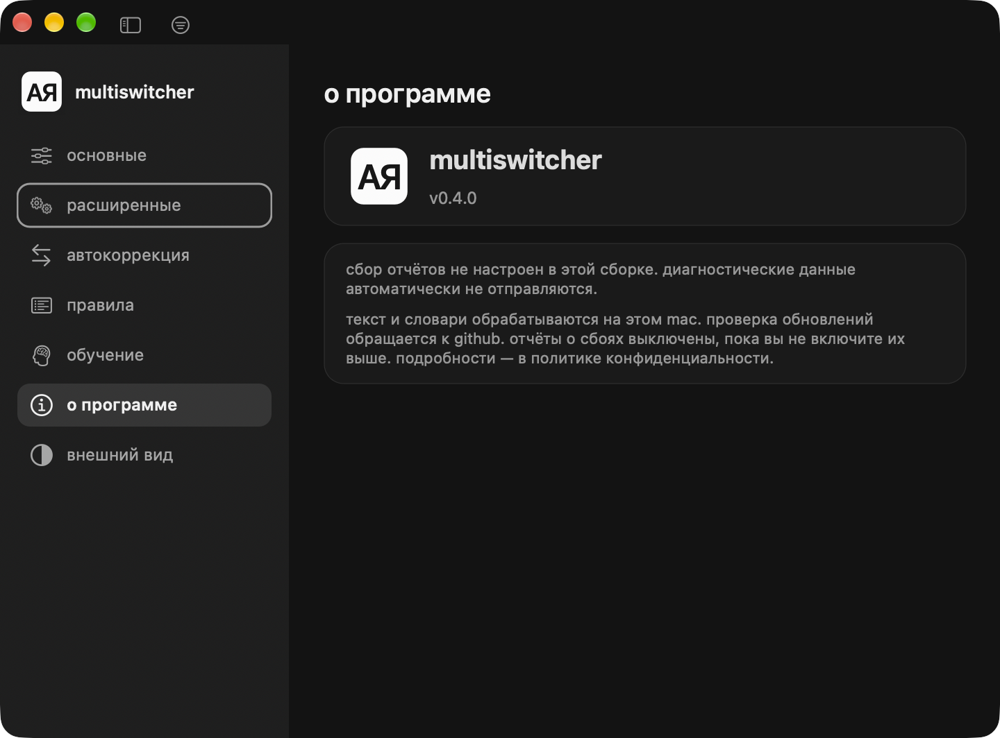
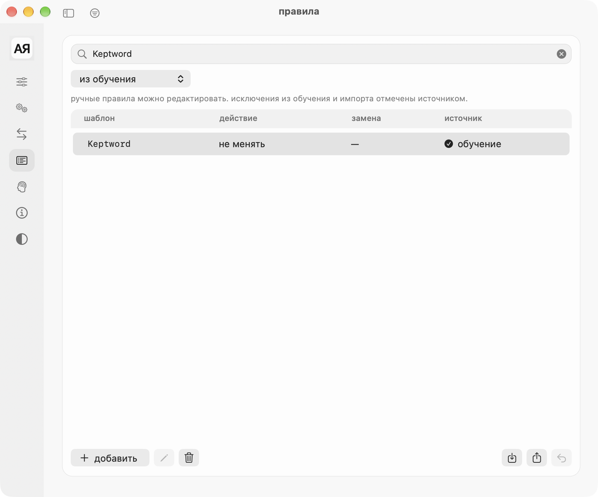
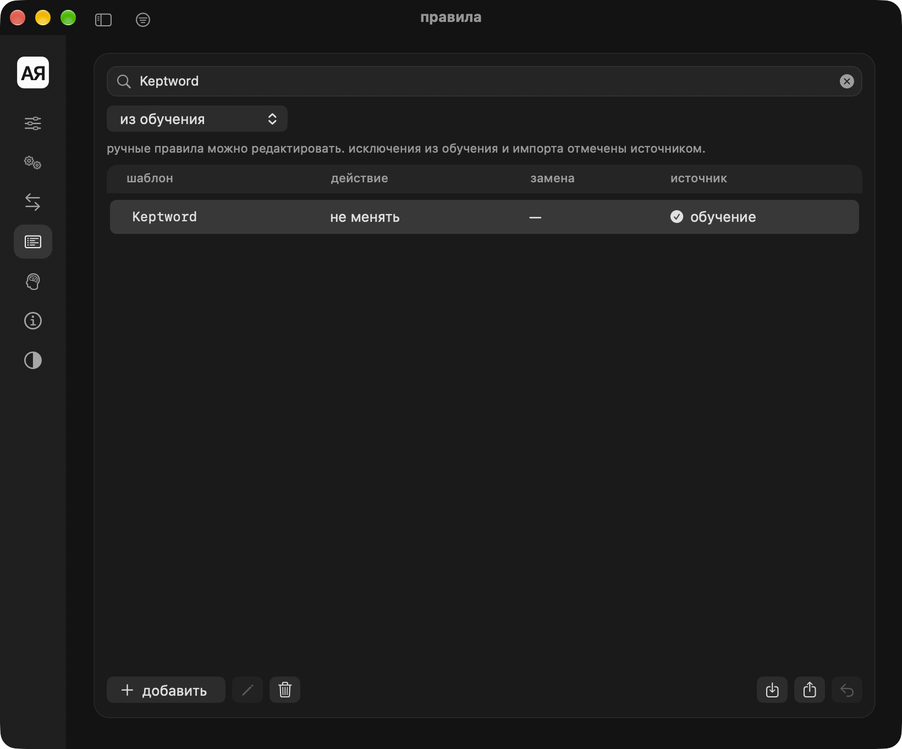

# Native settings and tray — 2026-10-24

## Changes

- Native AppKit buttons and text fields replace manual drawing and duplicate focus borders.
- Diagnostics groups the conversion checker and log controls; quit is a separate action.
- Exception lists have a visible viewport, footer, count and SF Symbol controls.
- Learning actions retain intrinsic widths and link active entries to their rule.
- Rules support all/manual/learned/imported filters; only manual rules are editable/exported.
- About uses a transparent rendering of the same AЯ master icon without external effects.
- Core algorithms, profile schema, learning thresholds and dictionaries are unchanged.

## Validation

SwiftPM: 22 tests passed. Shared checks: LayoutStateChecks 11, SidebarChecks 390, PopoverChecks 64 passed. UI probe: 84 states (seven sections, two themes, minimum/maximum/restored width, compact/expanded sidebar); geometry, navigation, restoration, keyboard, Reduce Motion and window bounds passed. Candidate/active learning action states and the real learned-rule navigation callback passed in both themes. New isolated-profile tests cover confirmation, source preservation, forgetting and empty first launch.

Both release apps built successfully. Strict deep code-signature verification passed for the bundles, extracted ZIPs and installed copies. Installed executables match their extracted ZIP counterparts. Both apps launched normally through Launch Services and are running from /Applications. MultiShift uses a local ad-hoc signature; notarization was not performed.

A full local snapshot was created through ProfileStore before testing. After installation, canonical hashes of all 390 rules, 19 learning entries and settings match the baseline. Personal profiles, backups and UserDefaults are absent from this report, distributable ZIPs and Git changes. Screenshots use an isolated synthetic review profile.

## Remaining manual acceptance

VoiceOver speech, physical left/right tray clicks, fast pointer movement through native submenus and the subjective smoothness of a completing operation during menu tracking have not been certified. The computer-control service repeatedly stalled; no synthetic menu screenshot is presented as evidence of actual menu tracking. Accessibility structure and automated keyboard checks do not establish VoiceOver speech behavior.

## Artifact hashes

- MultiSwitcher-native-settings.zip: `8040f57318025ffcaea765d6aa4ceea710af47cebb3f2181b6372aaa4b5667d5`
- MultiShift-native-tray.zip: `db0dffcfd1075b06dab1f09ad6ed1971252085790a8e5c9050b687d1719092f2`

ZIPs are local build artifacts, intentionally excluded from source control. See adjacent JSON reports for measured runtime checks.

## Real application captures

